<div align="center">

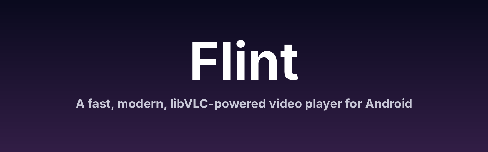

# Flint

**A fast, modern, libVLC-powered video player for Android.**

*VLC-grade playback 🎬 · Material 3 looks 🎨 · Built for modern Android 🤖*

[](https://developer.android.com/about/versions/nougat)
[](https://m3.material.io)
[](https://www.videolan.org/vlc/libvlc.html)
[](https://kotlinlang.org)
[](https://developer.android.com/jetpack/compose)
[](LICENSE)

[](https://github.com/heyyntn47-jpg/Flint-player/actions)
[](https://github.com/heyyntn47-jpg/Flint-player/releases)
[](https://github.com/heyyntn47-jpg/Flint-player/releases)
[](https://github.com/heyyntn47-jpg/Flint-player/stargazers)

[📦 Download](#-download) · [✨ Features](#-features) · [🛠️ Build](#%EF%B8%8F-build--install) · [🤝 Contribute](#-contributing) · [🙏 Credits](#-credits--acknowledgements)

</div>

---

## 💡 Why Flint?

VLC plays almost anything, but its interface shows its age. Flint keeps the part that matters, the **libVLC engine**, and wraps it in a clean **Jetpack Compose + Material 3** interface: gesture-first controls, a quick local library, and no ads or accounts.

- **Plays what other players can't**: libVLC handles nearly every container and codec.
- **Hardware first, software when needed**: if a hardware decoder fails on a file, Flint retries with software decoding from the same spot.
- **Feels native**: Material 3, dynamic color, smooth animations, picture-in-picture, background audio.
- **Open source**: GPL v3, no tracking, no ads.

## 📑 Table of contents

- [Why Flint?](#-why-flint)
- [Screenshots](#-screenshots)
- [Features](#-features)
- [Settings at a glance](#%EF%B8%8F-settings-at-a-glance)
- [Performance](#-performance)
- [Architecture](#-architecture)
- [Build & install](#%EF%B8%8F-build--install)
- [Download](#-download)
- [Contributing](#-contributing)
- [Credits](#-credits--acknowledgements)
- [License](#-license)
- [Disclaimer](#%EF%B8%8F-disclaimer)

## 📱 Screenshots

<div align="center">
<table>
  <tr>
    <td align="center">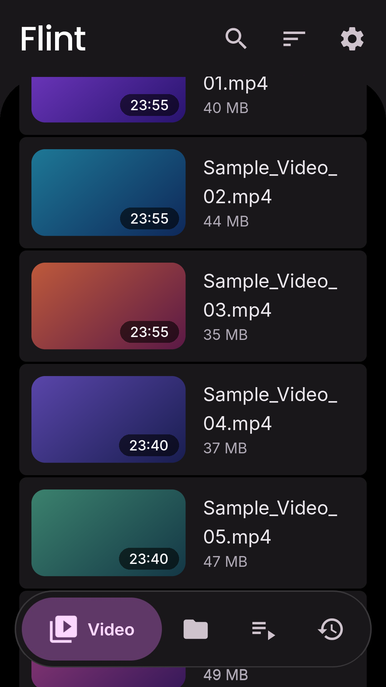<br/><sub>Home · Material</sub></td>
    <td align="center">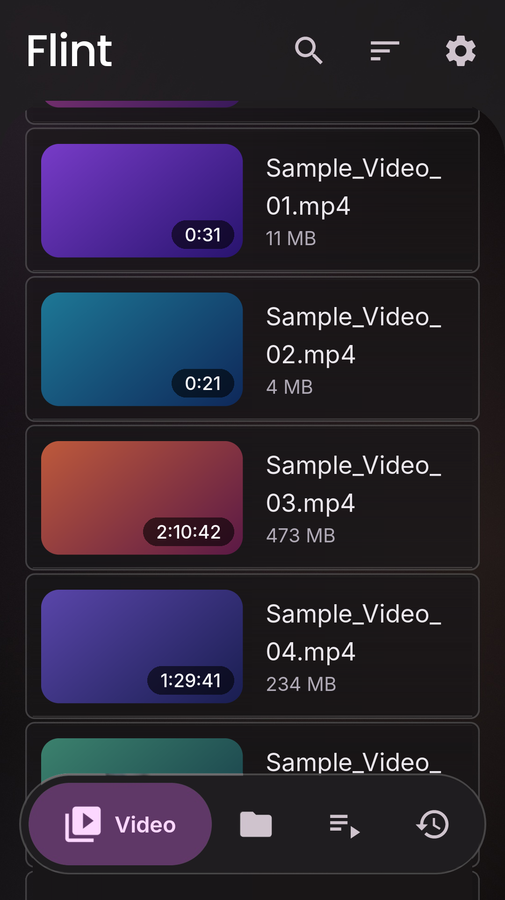<br/><sub>Home · Glass</sub></td>
    <td align="center">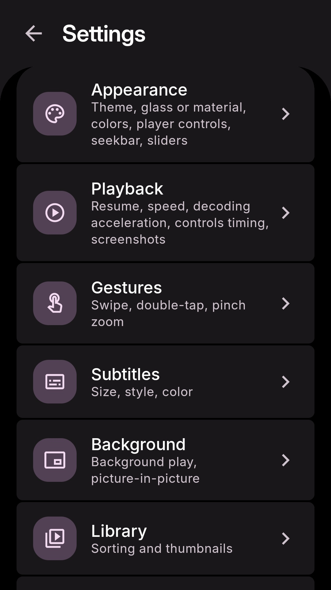<br/><sub>Settings</sub></td>
  </tr>
  <tr>
    <td align="center">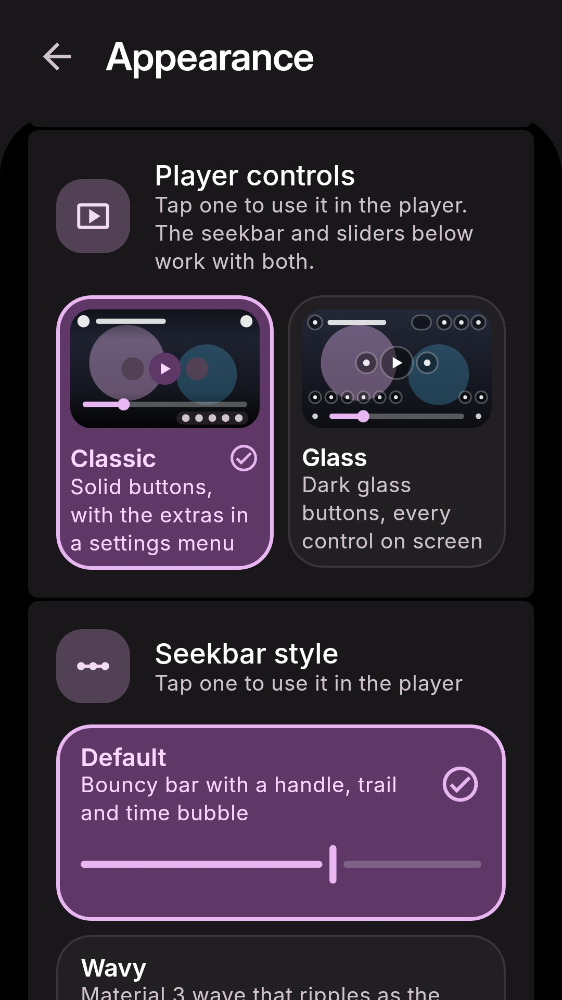<br/><sub>Player controls · Seekbar</sub></td>
    <td align="center">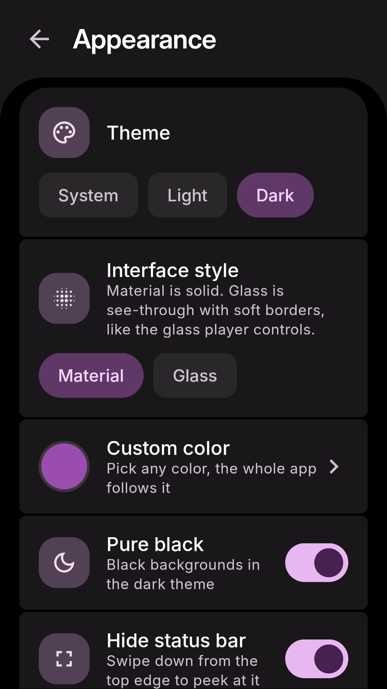<br/><sub>Theme · Glass · Custom color</sub></td>
    <td align="center">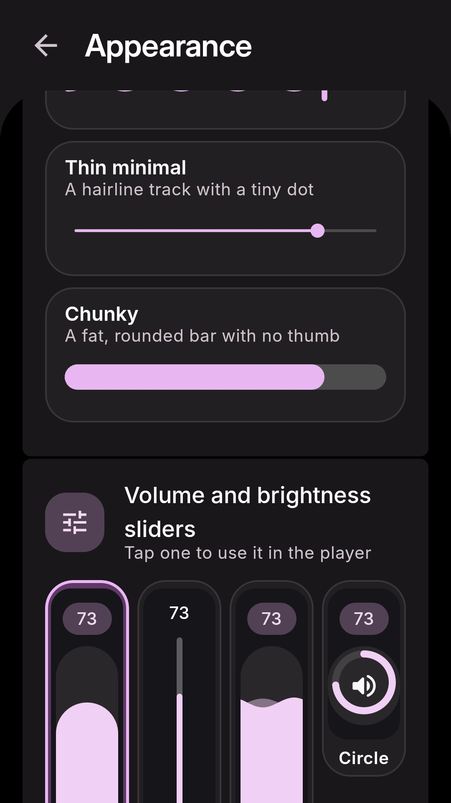<br/><sub>Seekbar and slider styles</sub></td>
  </tr>
  <tr>
    <td align="center">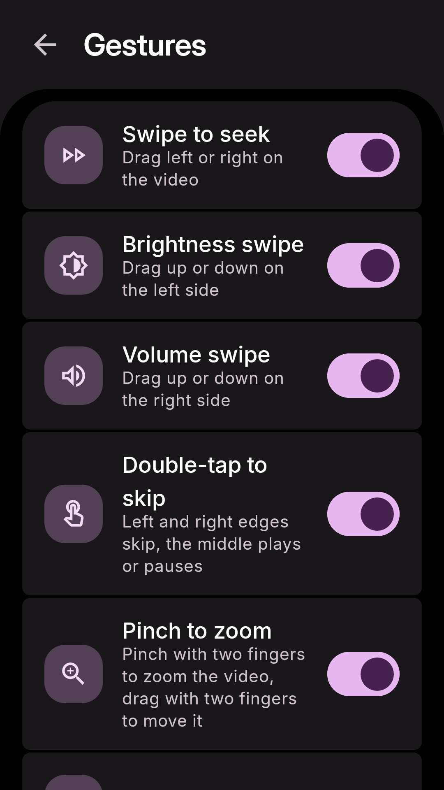<br/><sub>Gestures</sub></td>
    <td align="center">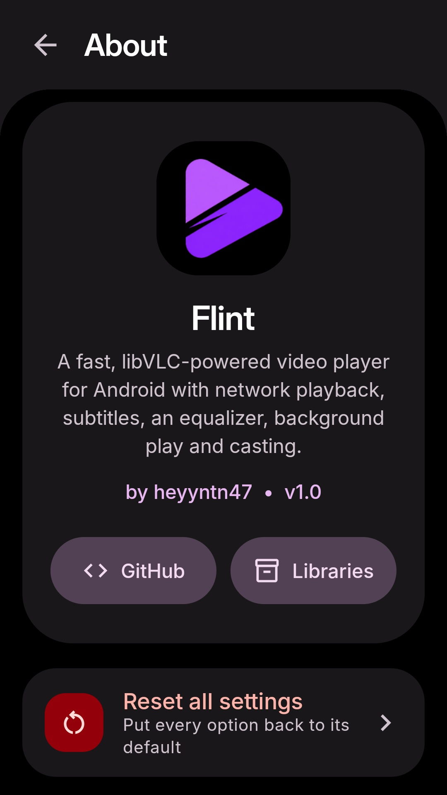<br/><sub>About</sub></td>
    <td></td>
  </tr>
</table>
</div>

### 🎞️ Player

<div align="center">
<table>
  <tr>
    <td align="center">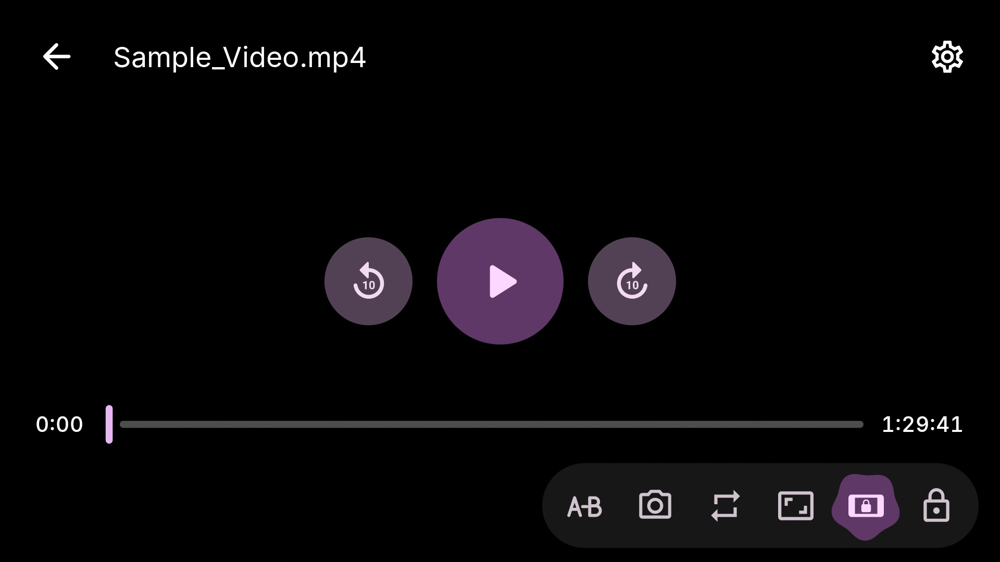<br/><sub>Classic controls</sub></td>
    <td align="center">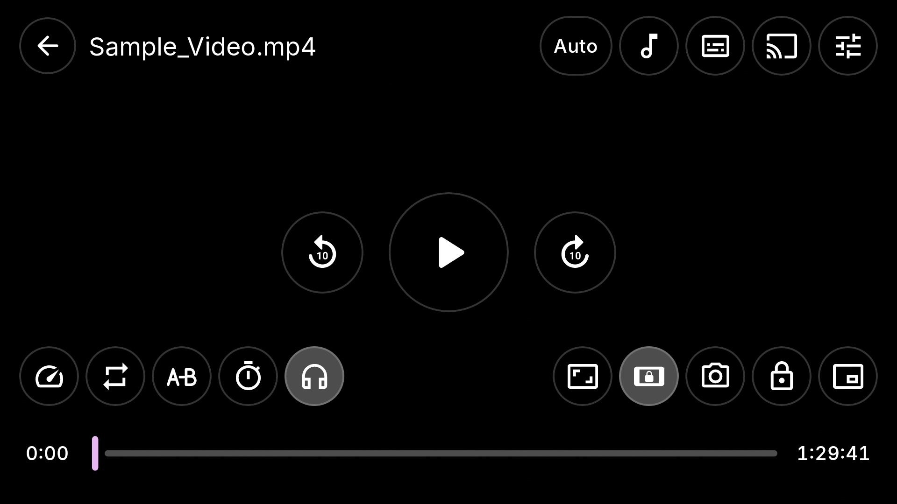<br/><sub>Glass controls</sub></td>
  </tr>
</table>
</div>

## ✨ Features

### 🎬 Playback engine (libVLC)

- **Hardware decoding first**, with automatic software fallback when a decoder fails
- **Decoder modes**: Auto, Software only, or Hardware+ (forced), switchable per session
- **Wide format support**: whatever libVLC can open (MP4, MKV, AVI, WebM, TS, and more)
- **Subtitles**: embedded tracks and external files. SRT, WebVTT, ASS/SSA, TTML/DFXP, SAMI, MicroDVD, SubViewer, SBV and LRC are converted to SRT on import
- **Subtitle styling**: size, color, and outline, shadow or background style
- **Multiple audio tracks**, with live track switching
- **Playback speed**, **aspect ratio** (fit, stretch, crop) and orientation lock
- **Queue** with shuffle and repeat (off, one, all)
- **Picture-in-picture** (Android 8+)
- **Background playback** with a media-session notification (play, pause, next, previous, seek)
- **Resume** where you left off
- **Open from other apps**: handles `video/*`, `content://`, `file://`, `http(s)://`, HLS, `rtsp://`, `rtmp://`, `mms://`, `smb://`, `ftp://`, `sftp://`, `nfs://`, `udp://` and `rtp://` links

### 🎨 Material 3 UI

- **Dynamic color** from your wallpaper (Android 12+), or a **custom seed color** (HCT palettes via Material Kolor)
- **Dark and light** themes
- **Two interface styles**: *Material* (solid surfaces) or *Glass* (translucent cards, bars and dialogs with soft glows)
- **Pure black** option for OLED screens
- **Two player control looks**: *Classic* and *Glass*, each button on its own glass pill
- **4 seekbar styles**: Default (bouncy), Wavy (Material 3 wave), Thin minimal, Chunky
- **4 gesture slider styles**: Pill, Lines, Waves, Circle
- **Expressive shapes, morphing controls and motion**
- **Inter** typography
- **Adaptive layouts**: orientation, screen-size and density changes don't restart playback

### 📂 Media library

- **Folder browsing** and an all-videos view from MediaStore, with folders you can include or exclude from scans
- **Thumbnails** with a memory and disk cache, generated off the main thread
- **Search** and **sorting**
- **Playlists** (create, rename, reorder) and **history**
- **File actions**: rename, share, delete and more from the context menu

### 🌐 Network

- **SMB, FTP, SFTP and NFS**: save servers, browse their folders and play videos straight from your NAS, PC or router
- **Network discovery**: finds SMB, NFS, FTP and UPnP / DLNA servers on your Wi-Fi
- **Web playlists**: open an M3U, PLS or XSPF link as a playlist
- **Stream options**: per-link network cache, user agent, referrer, subtitle link, RTSP over TCP and auto-reconnect; recent and favorite streams
- **Network streams**: paste HTTP(S), HLS, DASH, RTSP, RTMP, MMS, UDP or RTP links
- Logins are saved on the phone only and added when a file is opened, never stored in history urls

### ⚙️ Advanced

- **10-band equalizer** with presets and a pre-amp
- **Volume boost** up to 200%
- **Audio delay** and **subtitle delay** (±10 s and ±30 s)
- **Gesture controls** for brightness, volume and seeking, plus double-tap zones
- **A-B repeat**: tap to set A, tap to set B (the loop starts), tap again to clear; loop points show on every seekbar style
- **Pinch to zoom** up to 5x, drag with two fingers to move (works with Fit, Stretch and Crop)
- **Screenshots**: clean video frame (no controls or subtitles) saved to `Pictures/Flint` as JPEG or PNG
- **Controls auto-hide** timing: 2 s, 3.5 s, 5 s, 8 s, 12 s or never
- **Sleep timer** with a gentle fade-out, or "after this video"
- **Casting** to TVs and speakers discovered on your network (libVLC renderers)
- **Screen lock** to prevent accidental touches

### Flint vs VLC for Android

| | Flint | VLC for Android |
|---|:---:|:---:|
| Decoding engine | libVLC | libVLC |
| Hardware decoding with software fallback | ✅ | ✅ |
| Material 3 + dynamic color | ✅ | Partial |
| Jetpack Compose UI | ✅ | ❌ (mostly Views) |
| Equalizer, audio and subtitle delay | ✅ | ✅ |
| Subtitle auto-conversion to SRT | ✅ | ❌ |
| Picture-in-picture, background play | ✅ | ✅ |
| Local video library, playlists, history | ✅ | ✅ |
| Music library and audio-first UI | ❌ | ✅ |
| Network browsing: SMB, FTP, SFTP | ✅ | ✅ |
| Network browsing: UPnP/DLNA, NFS | ✅ | ✅ |
| Network browsing: WebDAV | ❌ | ✅ |
| Android TV | ❌ | ✅ |

Flint is a focused video player, not a VLC replacement. If you need a music library, WebDAV or Android TV today, use VLC.

## ⚙️ Settings at a glance

| Category | What you can change |
|---|---|
| 🎨 **Appearance** | Theme, Material or Glass, dynamic or custom color, pure black, player controls, seekbar and slider styles |
| ▶️ **Playback** | Resume, default speed and aspect, decoder mode, controls auto-hide, screenshot format |
| 👆 **Gestures** | Swipe, double-tap seconds, pinch zoom |
| 💬 **Subtitles** | Size, color, outline / shadow / box style |
| 🔊 **Background** | Background play, picture-in-picture, auto PiP |
| 📚 **Library** | Sorting, view mode, thumbnail pre-warming |
| 📁 **Folders** | Choose which folders are scanned |
| 🔒 **Storage & privacy** | Clear history and cache, history on or off |
| ℹ️ **About** | Version, libraries, reset all settings |

## 🚀 Performance

Flint is built to stay out of libVLC's way.

- **SurfaceView video path**: video renders on a `SurfaceView` through libVLC's `VLCVideoLayout`, not a `TextureView`. Frames go straight to the compositor.
- **Hardware acceleration by default**: MediaCodec decoding, with a one-shot software retry if it fails.
- **Warm start**: libVLC is created on a background thread at launch, and the first hardware decoders are pre-opened, so the first video starts faster.
- **Device-aware tuning**: low-RAM and weak devices get a larger buffer and cheaper software-decode settings.
- **Lean UI during playback**: the seek bar reads playback position from an isolated state holder, so a tick redraws the seek bar and time labels, not the whole screen.
- **Release off the main thread**: `stop()` and `release()` on the player run on a worker thread.
- **Baseline profile** for faster cold start (installed via ProfileInstaller).
- **Android 7.0 (API 24) and up.**

> Frame rate on a given phone depends on the file, the codec and the device. Measure on your own hardware.

## 🧱 Architecture

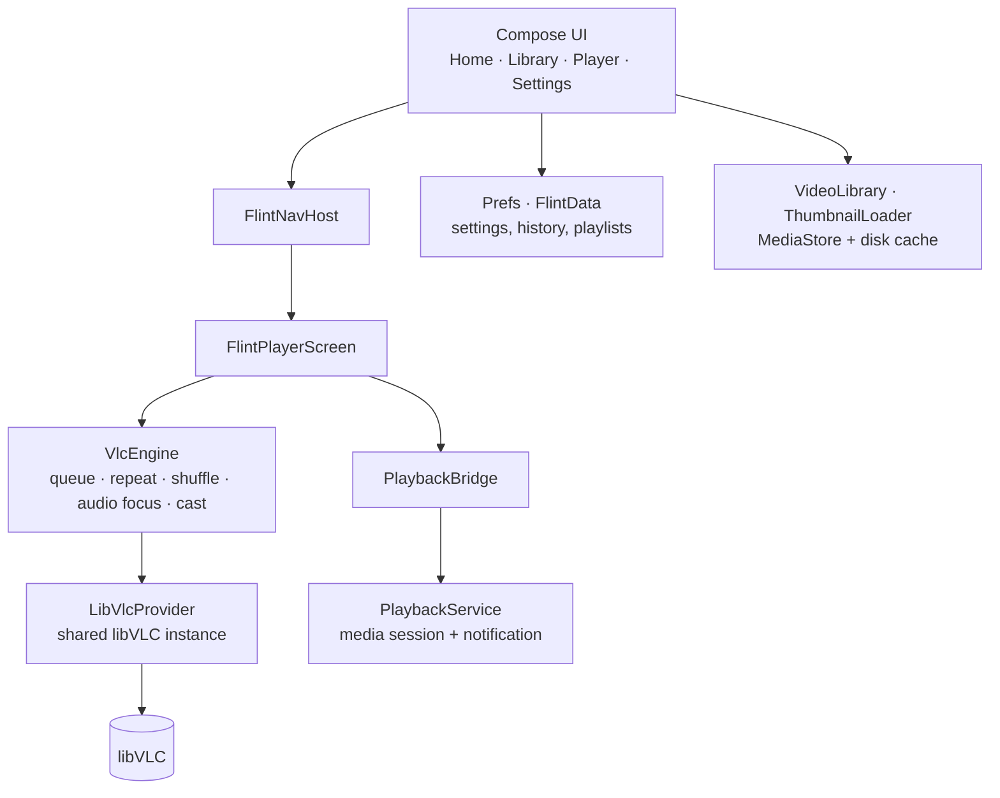

### Tech stack

| Area | Library |
|---|---|
| Language | Kotlin 2.4 |
| UI | Jetpack Compose 1.12, Material 3 1.5 |
| Playback and network access | libVLC 3.7 (`org.videolan.android:libvlc-all`) |
| Navigation | Navigation Compose |
| Theming | Material Kolor (HCT color schemes) |
| Startup | AndroidX ProfileInstaller |
| Concurrency | Kotlin Coroutines |
| Build | Gradle (Kotlin DSL), AGP 9 |

### Project layout

```
app/src/main/java/com/flint/player/
├── FlintApp.kt        Application: init data, warm up libVLC
├── MainActivity.kt    Single activity, incoming video intents
├── navigation/        NavHost and routes
├── home/ browse/      Home screen, folder browsing, sort menu
├── library/           MediaStore queries, thumbnails, file actions
├── history/ playlists/
├── stream/            Network stream dialog, playlist import (M3U / PLS / XSPF), recent + favorites
├── network/           SMB / FTP / SFTP / NFS servers, discovery, folder browser, login handling
├── player/            VlcEngine, LibVlcProvider, service, controls, seek bar, subtitles, PiP
├── data/              Prefs, FlintData, UriAccess
├── settings/          Settings and About
├── ui/                Theme, typography, shared components
└── util/              Logger
```

There is no dependency-injection framework: state lives in a few singletons (`Prefs`, `FlintData`, `LibVlcProvider`).

## 🛠️ Build & install

### Requirements

- Android Studio (current stable) or the command line
- **JDK 17**
- Android SDK with **`compileSdk 37`**
- Gradle **9.5.0** (the included wrapper downloads it for you)
- No NDK needed: libVLC ships prebuilt native libraries

### Clone and build

```bash
git clone https://github.com/heyyntn47-jpg/Flint-player.git
cd Flint-player

./gradlew :app:testDebugUnitTest     # unit tests
./gradlew :app:assembleDebug         # debug APK
./gradlew :app:assembleRelease       # release APK
```

Output: `app/build/outputs/apk/`


### ABIs

libVLC adds roughly 20 MB per architecture, so Flint builds **one APK per ABI** (`splits { abi { … } }` in `app/build.gradle.kts`) plus a universal one:

`app-armeabi-v7a-release.apk` · `app-arm64-v8a-release.apk` · `app-x86-release.apk` · `app-x86_64-release.apk` · `app-universal-release.apk`

GitHub Actions does the same and renames them `Flint-<version>-<abi>.apk`. See [`docs/RELEASING.md`](docs/RELEASING.md).

### Release signing

Release builds read signing details from `keystore.properties` in the project root, or from environment variables in CI:

```properties
storeFile=flint-release.jks
storePassword=...
keyAlias=...
keyPassword=...
```

CI variables: `FLINT_KEYSTORE_FILE`, `FLINT_KEYSTORE_PASSWORD`, `FLINT_KEY_ALIAS`, `FLINT_KEY_PASSWORD` (fed from the repository secrets `KEYSTORE_BASE64`, `KEYSTORE_PASSWORD`, `KEY_ALIAS`, `KEY_PASSWORD`).

Without a key, the release build falls back to the debug key. **Never distribute that APK, and never commit `*.jks` or `keystore.properties`.**

### F-Droid / Play Store notes

- **F-Droid:** the app is GPL v3 and uses open-source dependencies, so it is a candidate. libVLC comes from Maven Central as a prebuilt binary, which F-Droid may ask you to build from source.
- **Play Store:** GPL v3 apps can be published, but you must still provide source and the license text. See [License](#-license).

## 📦 Download

[](https://github.com/heyyntn47-jpg/Flint-player/releases/latest)

| Source | Status |
|---|---|
| GitHub Releases | [Latest release](https://github.com/heyyntn47-jpg/Flint-player/releases/latest) |
| F-Droid | Not yet available |
| Google Play | Not yet available |

**Which APK?**

| Your phone | Download |
|---|---|
| Almost any phone from 2017 on | `arm64-v8a` |
| Older 32-bit phone | `armeabi-v7a` |
| Emulator, Chromebook, x86 tablet | `x86_64` or `x86` |
| Not sure | `universal` (bigger, works everywhere) |

Each release also lists `SHA256SUMS.txt` so you can check your download.

Requires **Android 7.0 (API 24)** or newer.

## 🤝 Contributing

Contributions are welcome.

1. **Open an issue first** for anything bigger than a small fix.
2. Fork the repo and create a branch: `git checkout -b feature/my-change`.
3. Follow the existing style (see `.editorconfig`): Kotlin official code style, 4-space indents.
4. Run `./gradlew :app:testDebugUnitTest` and make sure the app builds.
5. Open a pull request that says **what** changed and **why**. Add screenshots for UI changes.

**Please:**

- Keep playback code off the main thread where it can block.
- Don't log inside per-frame or per-tick paths.
- Don't add new dependencies without discussing them first.
- Every new source file should carry the SPDX header. See [`CONTRIBUTING.md`](CONTRIBUTING.md).

**Bug reports** should include your device, Android version, the file's codec and container, and the decoder mode in use. Logs from `adb logcat -s Flint` help a lot.

## 🙏 Credits & acknowledgements

Flint stands on the shoulders of great open-source work. Thank you to:

- 🎞️ **[VideoLAN](https://www.videolan.org/) and the VLC team**: libVLC, the engine that makes Flint possible
- 🤖 **Google and the Android team**: Jetpack Compose, Material 3, AndroidX
- 🎨 **[Jordon de Hoog](https://github.com/jordond) and the [Material Kolor](https://github.com/jordond/MaterialKolor) contributors**: HCT-based color schemes
- 🔤 **[Rasmus Andersson](https://github.com/rsms) and the [Inter](https://github.com/rsms/inter) project**: UI typography
- 🔤 **[Indian Type Foundry](https://github.com/itfoundry/Poppins)**: Poppins, used for the Flint wordmark
- 🟣 **JetBrains**: Kotlin and Kotlin Coroutines
- 🛡️ **[Shields.io](https://shields.io)** and **[Star History](https://star-history.com)**: README badges and charts
- 👨‍💻 **[heyyntn47-jpg](https://github.com/heyyntn47-jpg)**: creator and maintainer of Flint

| Library | License |
|---|---|
| libVLC | LGPL 2.1 or later |
| Jetpack Compose, Material 3, Activity, Navigation, ProfileInstaller | Apache 2.0 |
| Material Kolor | MIT |
| Inter, Poppins | SIL OFL 1.1 |

Full third-party details: [`NOTICE.md`](NOTICE.md) and [`licenses/FONTS.md`](licenses/FONTS.md).

**Contributors:** thanks to everyone who helps. See the [contributors graph](https://github.com/heyyntn47-jpg/Flint-player/graphs/contributors).

*Inspired by VLC. Flint is an independent project.*

## 🗂️ More docs

| File | What's inside |
|---|---|
| [`CHANGELOG.md`](CHANGELOG.md) | What changed in each release |
| [`docs/RELEASING.md`](docs/RELEASING.md) | Signing key and release steps |
| [`docs/APP_ICON.md`](docs/APP_ICON.md) | How to change the app icon |
| [`CONTRIBUTING.md`](CONTRIBUTING.md) | How to contribute |

## 📄 License

Flint is licensed under the **GNU General Public License v3.0**. See [`LICENSE`](LICENSE) for the full text and [`NOTICE.md`](NOTICE.md) for third-party notices.

In plain terms:

- You can use, study, modify and share Flint.
- If you distribute Flint or a modified version (including as an APK), you must make the **complete corresponding source** available under **GPL v3** and keep the copyright notices.
- Derivative works must stay GPL v3. You cannot close the source.
- Using it commercially is allowed, but those same obligations apply to you.

**About libVLC:** libVLC is licensed under **LGPL 2.1 or later**. LGPL 2.1+ code can be combined with GPL v3 code, and the combined work is distributed under GPL v3. Flint keeps libVLC's own license and credits intact.

## ⚠️ Disclaimer

Flint is **not affiliated with, endorsed by, or sponsored by VideoLAN**. "VLC" and the VLC cone are trademarks of VideoLAN. Flint uses the libVLC library under its open-source license.

Flint plays files you provide. You are responsible for having the right to play them.

Saved network logins are stored as plain text in the app's private storage, like most player apps. Use a read-only account for shares you care about.

## ⭐ Star history

[](https://star-history.com/#heyyntn47-jpg/Flint-player&Date)

<div align="center">

Made with ❤️ using libVLC + Jetpack Compose

</div>
